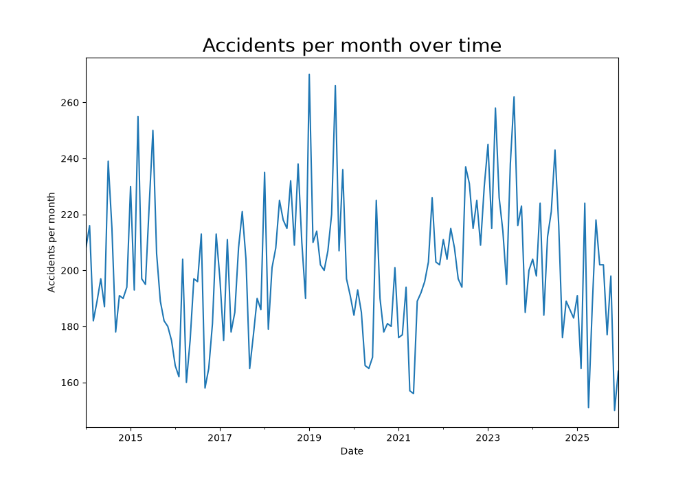
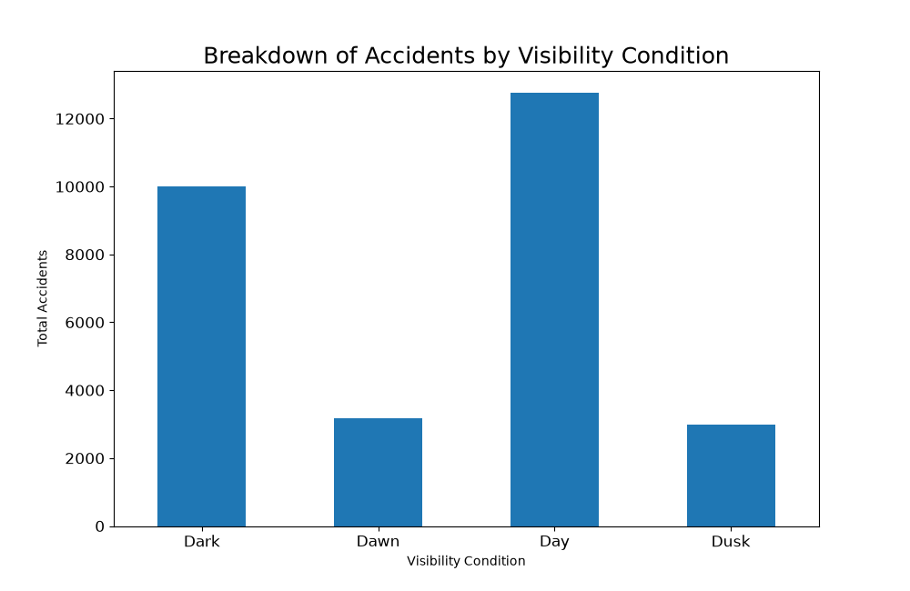

# Appendix

## Exploratory Graphs

These graphs were produced to gain an initial understanding of the accidents data set. They were made before we identified that some accidents were reported multiple times (if more than one company was involved) so the charts are not accurate and inflate the total number of observed accidents.. 

This charts monthly total accidents across all companies from the year 2014- 2022.

This chart aggregates the total amount of accidents by the visibility condition during the accident 

