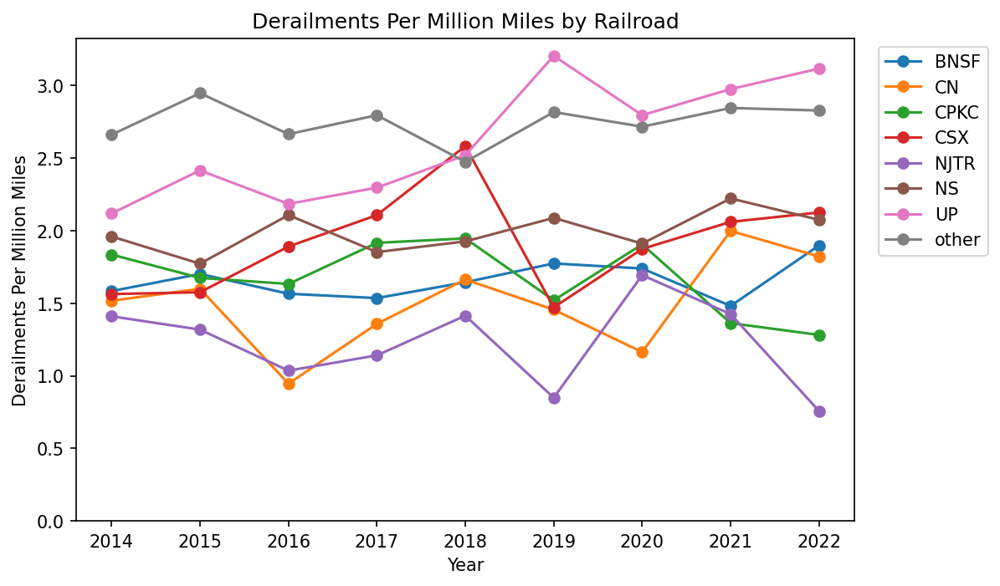
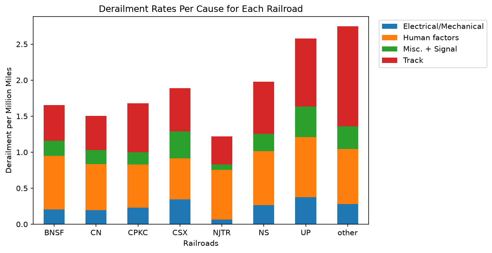
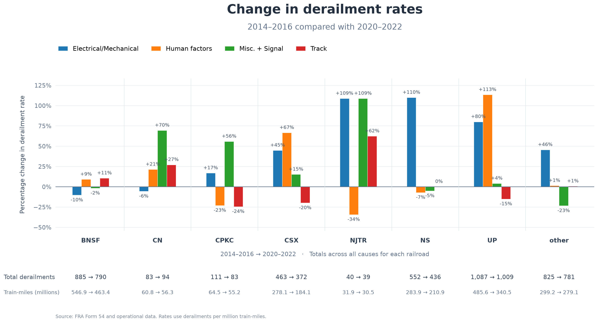

### bevo_big_data

# An Analysis of Train Derailments for Major U.S. Railroad Companies 

## Goal
Question: How do derailment rates in the US per million train miles change across railroads from 2014 to 2022 and what caused them?

## Data Sources and Data Collection
This project uses two datasets provided by the Federal Railroad Administration (FRA), an agency of the U.S. Department of Transportation (USDOT). The datasets provide complementary information: one records reportable railroad accidents and incidents, while the other contains operational data that can be used to measure railroad activity. Combining these sources allows the analysis of accident trends in relation to operational exposure.

### 1. FRA Rail Equipment Accident/Incident Data (Form 54)
- Official dataset name: Rail Equipment Accident/Incident Data (Form 54)
- Original source: https://data.transportation.gov/Railroads/Rail-Equipment-Accident-Incident-Data-Form-54-/85tf-25kj/data_preview
- Data dictionary: https://data.transportation.gov/Railroads/Rail-Equipment-Accident-Incident-Data-Form-54-/85tf-25kj/about_data
- The Rail Equipment Accident/Incident Data (Form 54) is a publicly available dataset maintained by the Federal Railroad Administration (FRA). It contains records of reportable railroad equipment accidents and incidents in the United States, including derailments, collisions, fires, explosions, and other events involving railroad on-track equipment, whether standing or moving.
- Under federal reporting requirements, railroads must report qualifying accidents and incidents to the FRA using Form FRA 6180.54 — Rail Equipment Accident/Incident. These reports include information about the event, such as its date, location, equipment involved, accident characteristics, and reported cause. Reporting requirements include events resulting in damages exceeding the applicable reporting threshold for the year in which the event occurred.
- The dataset is available in a human-readable format and can be accessed through the USDOT data portal. Users can explore the records online and obtain the data for further analysis through downloadable formats such as CSV and available data-access interfaces.
- In this project, the dataset serves as the primary source of accident information. It is used to identify derailments, examine their reported causes, and analyze how accident patterns vary across railroads and over time.
- The accompanying data dictionary documents the dataset's fields and their definitions, supporting the interpretation and selection of relevant variables for the analysis.
 #### Columns
- Year: year the figure was reported
- Reporting Railroad Code: Railroad company reporting the figure
- Reporting Parent Railroad Code: The company that owns the company reporting the figure
- Accident Number: The ID for the accident being reported
- Accident Type: What kind of accident is being reported
- Primary Accident Cause Code: What caused the accident

### 2. FRA Operational Data 1.02
- Official report name: Operational Data 1.02
- Original source: https://data.transportation.gov/stories/s/Operational-Data-1-02-/b39d-rg8e/
- Data query interface: https://explore.dot.gov/vizql/v_202532603161545/javascripts/hybrid-window/min/index.html?id=1k4jguhsn%24y5so-y7-oe-ay-a4vigd&moduleId=view_data
-Operational Data 1.02 is a report provided by the FRA containing railroad operational statistics reported to the agency. These data describe the volume of railroad activity and include measures such as train miles, employee hours worked, yard switching miles, passengers transported, passenger miles, and the number of individual reports submitted.
- Unlike the accident dataset, which documents specific events, Operational Data 1.02 provides measures of railroad activity that help describe the operational context in which accidents occur. Train miles are particularly relevant to this project because they can be used as an exposure measure when calculating derailment rates.
- The report's default display covers one year of data, and the published data are presented per railroad per month, filed under each railroad's headquarters location.Therefore, the company and temporal resolution of the operational data must be considered when combining them with the accident records.
- In this project, Operational Data 1.02 is used as the source of operational exposure data. The goal is to calculate derailment rates per million train miles and compare accident patterns over time and, where the available data support it, across railroads.
- The operational dataset complements the Form 54 records by providing a denominator for rate calculations, allowing the analysis to consider not only the number of derailments but also the amount of railroad activity.
#### Columns
- Year: year the figure was reported
- Reporting Parent Railroad Code: The company that ons the company reporting the figure
- Total Train Miles: The number of miles run by all the trains for that company for any reason

## Data Integration
- The two datasets serve different purposes and must be processed separately before they can be combined. Accident records are event-based, whereas operational statistics summarize railroad activity over a defined reporting period. Before calculating rates, the project must ensure that the accident counts and train-mile totals refer to compatible time periods and populations of railroad operations.
- To connect both datasets, we joined the railroad group and year, after each table is aggregated.
- The data dictionaries and source documentation will be used to interpret variables, identify missing information, and document the assumptions applied during data cleaning and analysis.

## Reproducing the Analysis
All required packages are located in the requirements.txt file, to install, run pip install -r requirements.txt. To run the entire analysis in one step (cleaning data, merging data, and building the graphs) you can run the `FRA_clean.py` file located in the code folder. From the project directory `python code/FRA_clean.py`. Below we explain the separate files and functions that make up `FRA_clean.py`.

### Cleaning and Merging the Data
The two datasets used in this project are the FRA Rail Equipment Accident/Incident Data and the FRA Operational Data. These datasets can be found under the data folder within this repository or can be downloaded from the FRA website directly (linked above). The `clean.py` file converts both data sets into pandas data frames, cleans them, and merges them into one data frame containing the columns "year", "railroad_group", "cause_group", "derailments", "total miles", and "rate_per_million_miles". 
### Clean Data
The first step is to clean and filter both data sets to get them to a point where they can be joined together. The function `clean_accidents` takes in the pandas data frame of the accidents data set labeled `df_accidents` and returns a new data frame that aggregates total derailments by cause, for each of the 8 companies, by year. The function `clean_operations` takes in the pandas data frame of the operations data set labeled `df_operations` and returns a data frame that aggregates total operation miles per company per year.
### Merge Data
The function `merge_dfs` takes in the two new data frames created in the cleaning step. It merges the cleaned data on the "year" and "railroad_group" columns. It also adds an additional column "rates_per_million_miles" which gives the rate at which derailments occurred, for a specific cause category, per million miles of operation within a given year for a specific company. 
### Final Clean
The `change_names` function converts each of the column names from the original dataset into snake case. The final function `clean_and_merge` combines the previous functions into one callable function that takes both of the uncleaned data frames as inputs and produces the final cleaned and merged data frame.

### Graphing the Data
The functions that build the graphs can be found in `charts.py`, each of them takes in the final cleaned dataframe that `clean.py` returns and saves the charts as .png files to the artifacts folder. The function `charts_over_time` plots the derailment rate per million miles by railroad company over time. The function `charts_by_cause` provides a breakdown of the derailment rates per million miles by cause for each company. The function `plot_change_chart` provides a visual description of the percent change in railroad derailment rates between two periods (2014-16 and 2020-22). These rates are broken down by company and accident cause. 

## Methodology
- Rate = derailments / (Total Train Miles(TTM)/1,000,000) TTM includes Yard Switching Miles.
- Groups: top 7 railroads by parent company plus other (BNSF, UP, NS, CSX, CPKC, CN, NJTR)
- Rate over time = one rate per railroad per year, summed of the four cause rates.
- Cause by railroad: years combined, derailments summed over years/ miles summed over years. Each railroad-year's miles counted once.
- Change chart - '14 - '16 vs -'20 - '22 rates, percent change = (late-early)/early * 100
- Cause groups: Signal merged with miscellaneous due to low numbers - would not be significantly shown if kept separate.

## Findings

- UP consistently has one of the highest rate of derailments for how many train miles they run.
- NJTR by contrast is one of the lowest.
- Betewen 2018 and 2019, CSX had one of the largest single year decreases in derailment rates out of any company.

- For relative size of causes to rates, NJTR is almost entirely human factors.
- Track derailments made up a large majority of their derailments while the other larger railroads have a more even mix.

- The share of Misc + Signal accidents for CN and CPCK grew dramatically between periods.
- CSX an UP had a massive swing in derailments caused by human factors.
- NS had a large swing in derailments caused by their locomotives.
- NJTR had the wildest swings across all cateogories but has the lowest number of both absolute and relative derailments, meaning any small change leads to huge swings in changes of rates.

## Limitations
- A key limitation is that Operational Data 1.02 is published per railroad according to the data. Therefore, regional derailment rates require operational exposure data broken down by the corresponding FRA regions. If suitable regional train-mile data are unavailable, per-railroad rates can still be calculated, but they cannot be interpreted as regional rates. The project will document this limitation and adjust the analysis to match the geographic resolution supported by the data.
- Miles by state, region, or line do not exist and so accident data cannot be used alongside operational data to find geographical differences.
- Amtrak, the national passenger railroad service, is not included in the data set
- Only accidents above a certain amount are reported to the FRA. If it's below the set threshold per year (10,500-11,300 depending on the year).
- Percent changes assume a non-zero early-period rate, and NJT's small counts make the percentages volatile compared to the other railroads.
- NJTR has a small absolute count and is a passenger railroad with different behavior than the other major railroads.
- The percent change in the period comparison graph assumes a non-zero early rate.
- "Per million miles" for all statistics includes yard switching miles.
- The railroads are self-reporting 

## Extensions to the Analysis
 - We had to exclude a regional comparison of accident data over time due to how each railroad reports their operational statistics to the FRA. However, using the FRA Crossing Inventory dataset, we could potentially estimate operational data to where it occurred per railroad across years. This dataset includes the railroad crossing information for trains that move over a specific piece of track within a given year. It includes the railroad, the state and county, the trains, and the year the count was taken. Combining this with segment lengths info gives an estimate of train miles per railroad per state. This would allow us to compare accident statistics per million miles per railroad for a given region. Another possible route is to get the operational data directly from the railroads but this is not normally public.
 - Further analysis is also possible by comparing the accidents consisting of mostly remote polited trains or train lines vs less automated trains. The question given is what overall effect of teams of humans (including the size of those teams) has on the accident rate for each railroad.
